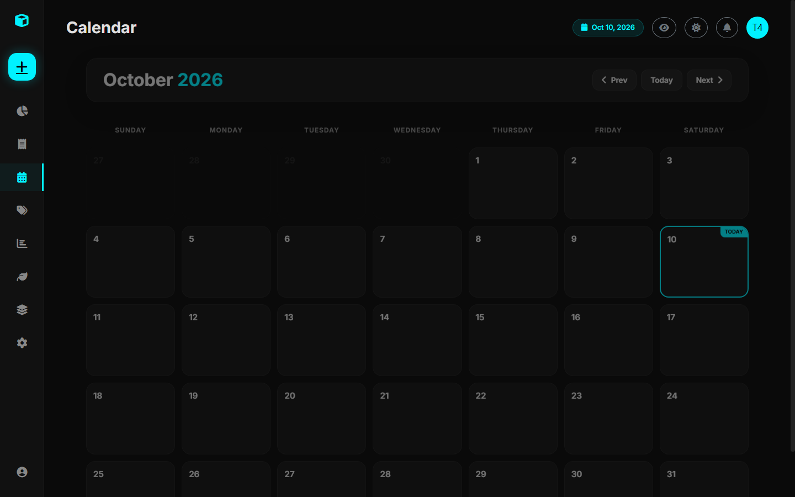
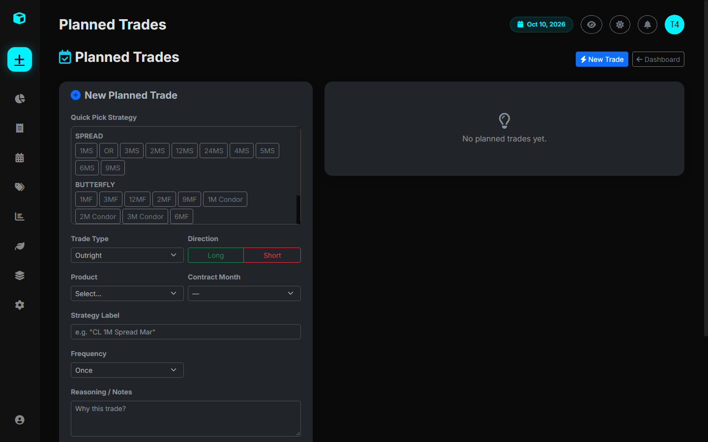

# Planning & Calendar

Successful trading requires planning setups well in advance, especially in commodities where seasonal patterns repeat year after year.

The **Calendar & Planned Trades** modules (`/calendar/` and `/planned/`) allow traders to pre-formulate trade hypotheses and track execution fidelity.

---

## 1. Trade Planning (`PlannedTrade`)

Traders can submit trade plans before entry with detailed reasoning and chart screenshots:

### Recurrence Options:
- **Once**: Single setup planned for a specific date.
- **Monthly**: Recurring monthly spread roll or rebalancing thesis.
- **Yearly**: Seasonal commodity setup recurring annually (e.g., February Grain Planting Intentions).
- **Specific Months**: Trades targeted for specific seasonal windows (e.g., March and September contract delivery roll dates).

---

## 2. Interactive Calendar View (`/calendar/`)

The calendar combines both **Planned Setups** and **Realized Trade Executions** on an interactive grid:
- **Execution Markers**: Displays completed trades color-coded by performance (Green for gains, Red for losses).
- **Planned Alerts**: Highlights active seasonal setup reminders scheduled for the current month.
- **Monthly Navigation**: Easily cycle backward and forward across historical trading months.
