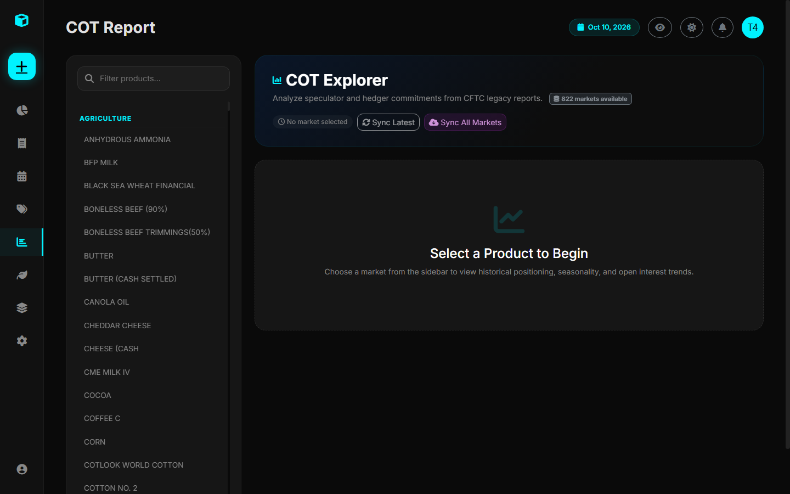
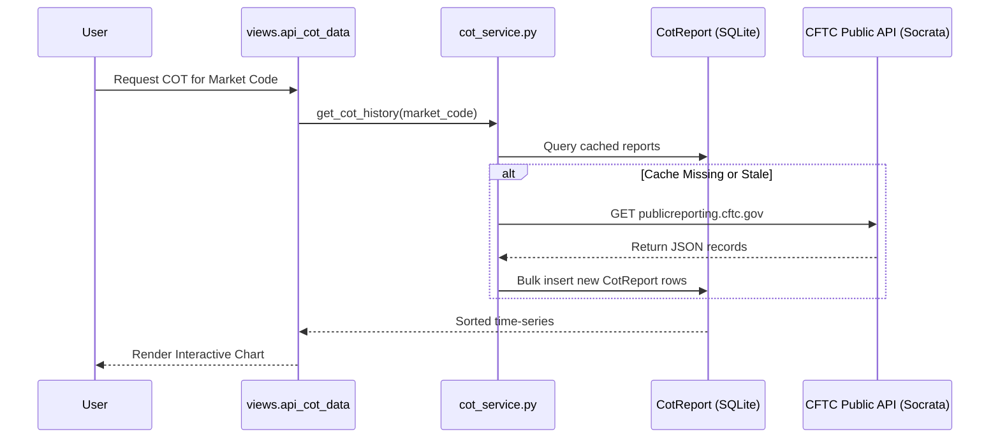

# CFTC Commitments of Traders (COT)

The **Commitments of Traders (COT)** module (`/cot/`) provides weekly positioning analytics released by the US Commodity Futures Trading Commission (CFTC).

---

## 1. Overview of the COT Report

Every Friday at 3:30 PM Eastern Time, the CFTC publishes breakdown reports reflecting trader positioning as of the preceding Tuesday. These reports illuminate:
- **Smart Money / Commercial Hedgers**: Producers, merchants, and processors actively hedging physical inventory.
- **Large Speculators / Managed Money**: Commodity Trading Advisors (CTAs), hedge funds, and quantitative trend-followers.
- **Small Speculators / Non-Reportable**: Retail traders and smaller market participants.

Analyzing extreme net positioning helps identify market exhaustion points, crowded trades, and high-probability reversal setups.

---

## 2. Supported Market Categories

The Trade Journal's automated market discovery engine caches over **1,300+ markets** across all major exchanges:

- **Agriculture**: Corn (CBOT), Soybeans (CBOT), Soybean Meal, Soybean Oil, Wheat (CBOT & KCBT), Rough Rice, Oats, Live Cattle (CME), Feeder Cattle (CME), Lean Hogs (CME), Coffee C (ICE), Sugar No. 11 (ICE), Cocoa (ICE), Cotton No. 2 (ICE).
- **Energy**: WTI Crude Oil (NYMEX), Brent Crude (ICE), Natural Gas (NYMEX), Heating Oil, RBOB Gasoline.
- **Metals**: Gold (COMEX), Silver (COMEX), Copper (COMEX), Platinum (NYMEX), Palladium (NYMEX).
- **Financials & FX**: Euro FX, British Pound, Japanese Yen, 10Y US Treasury Notes, S&P 500 E-mini, Nasdaq 100 E-mini.

---

## 3. Data Ingestion Architecture

---

## 4. How to Sync Markets

To ensure all market codes are up to date:
1. Navigate to the **COT Report** page (`/cot/`).
2. Click the **"Sync All Markets"** button in the sidebar.
3. The platform will query the CFTC API endpoint, populate `cftc_markets_cache.json`, and refresh the market dropdown list.
