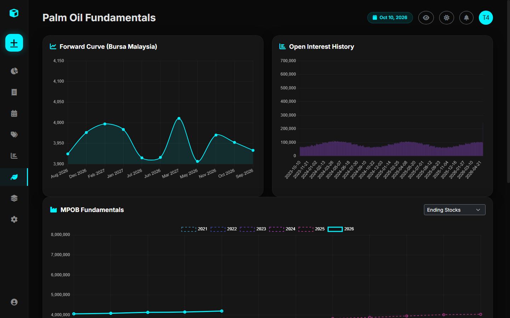

# Palm Oil (FCPO) Fundamentals

The **Palm Oil Dashboard** (`/palm-oil/`) is a specialized fundamental analysis hub tailored to traders participating in **Bursa Malaysia Derivatives (BMD) Crude Palm Oil (FCPO)** futures.



---

## 1. Why Palm Oil Fundamentals Matter

Crude Palm Oil is the most widely consumed edible vegetable oil in the world. Its price dynamics are governed by a tight interplay between:
- Biological production seasonality in Malaysia and Indonesia.
- Physical import demands from major consuming nations (India, China, the EU).
- Cross-commodity spreads against **CBOT Soybean Oil (BO)** and **Dalian Palm Olein (P)**.

---

## 2. Integrated Data Pillars

The dashboard aggregates three distinct fundamental streams:

### A. Forward Price Curve & Open Interest (`PalmOilPriceAndOI`)
- Visualizes daily settlement prices across forward contract tenors (Month 1 through Month 12).
- Displays Open Interest (OI) concentration across contracts to highlight liquid benchmark months (typically the third contract month).

### B. MPOB Monthly Balance Sheet (`MPOBData`)
Official monthly statistics published by the **Malaysian Palm Oil Board (MPOB)**:
- **Production**: Total CPO output in metric tonnes.
- **Imports**: Raw oil inflows.
- **Exports**: Total outflows to destination markets.
- **Domestic Consumption**: Local industrial disappearance.
- **Ending Stocks**: Month-end storage levels (critical indicator of market tightness).

### C. High-Frequency Surveyor Estimates (`ExportSurveyorData`)
Before official monthly MPOB numbers are published, independent cargo inspection surveyors provide high-frequency export pulse data:
- **Surveyors**: **ITS** (Intertek Testing Services), **AmSpec Agri**, and **SGS**.
- **Reporting Intervals**: Day 1–10, Day 1–15, Day 1–20, Day 1–25, and Full Month.

---

## 3. Seeding Sample Palm Oil Data

To populate the dashboard with realistic multi-year historical data for testing:

```bash
python manage.py seed_palm_oil
```

This management command seeds:
- 12 months of MPOB balance sheets.
- Corresponding surveyor estimates from SGS, ITS, and AmSpec.
- Daily forward price curves and contract open interest.
