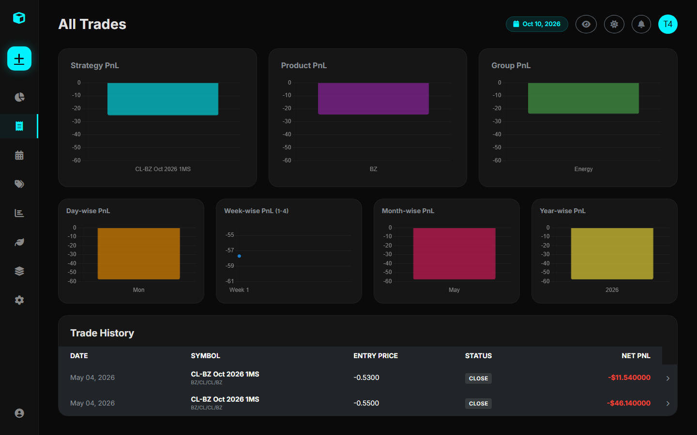

# Position Adjustments & Audit Trail

Rather than storing a static contract count that is destructively overwritten, the Trade Journal implements an **Event-Sourced Position Audit Log** via the `PositionAdjustment` model.

---

## 1. Why Position Adjustments Matter

Real-world institutional trading rarely consists of opening 10 contracts and liquidating all 10 contracts in one transaction. Professional desks constantly:
- **Scale In**: Add to winning positions as confirmations occur.
- **Scale Out (De-risk)**: Partially reduce size at first targets while trailing stops on the remainder.
- **Average Down / Rebalance**: Adjust positions across changing price regimes.

A static database schema destroys historical fill context. The Trade Journal's audit trail preserves every action in chronological order.

---

## 2. The Four Adjustment Actions

| Action | `size_change` | PnL Effect | Status Transition |
| :--- | :--- | :--- | :--- |
| **`Open`** | Positive ($+N$) | None (Establishes position) | Trade status $\rightarrow$ `Open` |
| **`Add`** | Positive ($+N$) | None (Blends entry price) | Trade status $\rightarrow$ `Open` |
| **`Reduce`**| Negative ($-N$) | Locks in Realized PnL for closed lots | Trade status $\rightarrow$ `PartiallyReduced` |
| **`Close`** | Negative ($-N$) | Locks in final Realized PnL | Trade status $\rightarrow$ `Closed` |

---

## 3. Mathematical Formulas

### Volume-Weighted Average Entry Price (`avg_entry_price`)
When positions are added at varying prices, the platform calculates the volume-weighted average entry price across all `Open` and `Add` adjustments:

$$\bar{P}_{\text{entry}} = \frac{\sum_{i \in \{\text{Open}, \text{Add}\}} (|S_i| \times P_i)}{\sum_{i \in \{\text{Open}, \text{Add}\}} |S_i|}$$

Where:
- $S_i$ is the position size change of adjustment $i$.
- $P_i$ is the fill price of adjustment $i$.

---

### Realized PnL on Reductions (`pnl`)
When an existing position is partially reduced or closed, realized profit or loss is calculated using the weighted entry price and contract point value multiplier:

**For Long Trades:**
$$\text{Realized PnL} = (P_{\text{exit}} - \bar{P}_{\text{entry}}) \times \text{Multiplier} \times Q_{\text{reduced}}$$

**For Short Trades:**
$$\text{Realized PnL} = (\bar{P}_{\text{entry}} - P_{\text{exit}}) \times \text{Multiplier} \times Q_{\text{reduced}}$$

Where:
- $P_{\text{exit}}$ is the reduction/closure price.
- $\text{Multiplier}$ is resolved from `Products.xlsx`.
- $Q_{\text{reduced}}$ is the quantity of contracts closed.

---

## 4. State Recalculation Engine

If an adjustment record is edited or deleted, `services.recalculate_trade_state(trade_id)` automatically re-simulates all historical adjustments in chronological order (`timestamp ASC`). It recalculates running open sizes, blend prices, and updates all downstream PnL figures.
