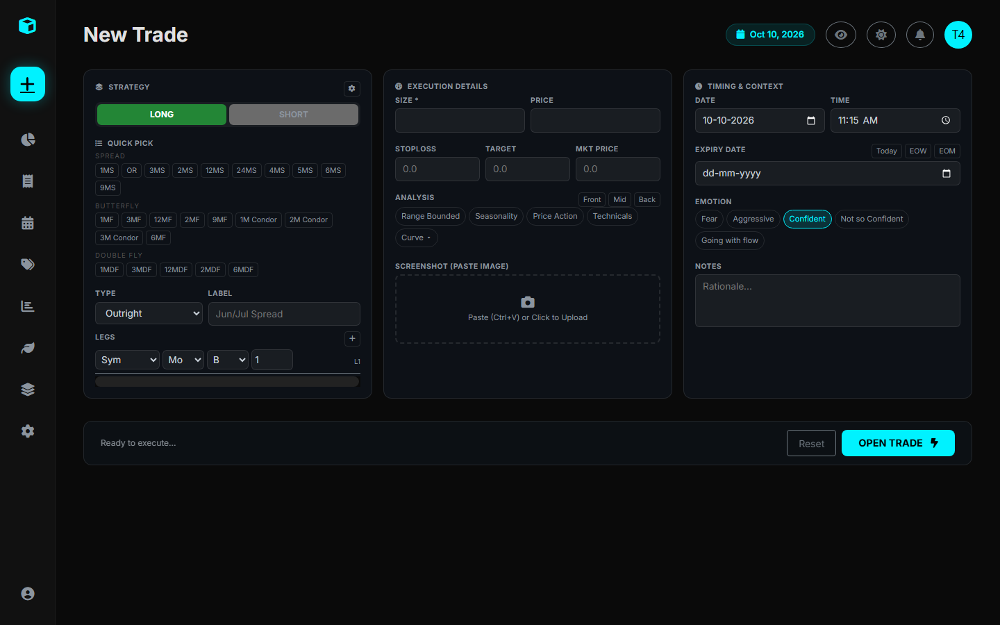

# Multi-Leg Trade Execution

A core strength of the Trade Journal is native support for **complex multi-leg derivative strategies** across commodities and futures markets.

---

## 1. Supported Strategy Structures

The platform models strategies through a parent `Trade` object containing one or more associated `TradeLeg` records:

### A. Outrights (1 Leg)
A direct directional position on a single contract month.
- **Example**: Long 5 contracts of `CL` (WTI Crude Oil) `Jun 2026`.

### B. Calendar Spreads (2 Legs)
Simultaneously buying and selling different expiration months of the same commodity to capitalize on forward curve slope changes (Contango / Backwardation).
- **Leg 1**: Buy 1x `CL Jun 2026`
- **Leg 2**: Sell 1x `CL Jul 2026`
- **Ratio Representation**: `[1, -1]`

### C. Butterfly Spreads (3 Legs)
A neutral spread combining an inner short strangle/straddle flanked by outer long contracts to profit from stable spread differentials with defined risk.
- **Leg 1**: Buy 1x `M1` (Month 1)
- **Leg 2**: Sell 2x `M2` (Month 2)
- **Leg 3**: Buy 1x `M3` (Month 3)
- **Ratio Representation**: `[1, -2, 1]`

### D. Double-Flies (4 Legs)
Four-legged calendar structure balancing curvature across two intermediate contract months.
- **Leg 1**: Buy 1x `M1`
- **Leg 2**: Sell 3x `M2`
- **Leg 3**: Buy 3x `M3`
- **Leg 4**: Sell 1x `M4`
- **Ratio Representation**: `[1, -3, 3, -1]`

### E. Inter-Product Spreads (2+ Legs)
Trading price differentials between two economically linked commodities (e.g., Brent vs. WTI Crude, Gas Oil vs. Heating Oil, or Soybean Crush: Soybeans vs. Soybean Meal + Oil).
- **Leg 1**: Buy 1x `CL Jun 2026`
- **Leg 2**: Sell 1x `BZ Jun 2026`

---

## 2. Trade Execution Parameters

When submitting a trade via `/trades/new/`:

| Parameter | Type | Purpose |
| :--- | :--- | :--- |
| **Trade Type** | Dropdown | Identifies strategy classification (`Outright`, `CalendarSpread`, `Butterfly`, etc.). |
| **Strategy Template** | Selection | Automatically populates leg ratios and relative month offsets from stored templates. |
| **Trade Date & Time**| Date / Time | Captures precise entry timestamp (defaults to current time). |
| **Position Size** | Float | Initial quantity of spread units entered. |
| **Entry Price** | Float | Executed fill price for the net strategy spread or outright. |
| **Stop Loss & Target**| Float | Planned risk boundaries for automatic reward-to-risk monitoring. |
| **Emotion Tag** | Dropdown | Emotional state at entry (`Fear`, `Aggressive`, `Confident`, `Going with the Flow`). |
| **Analysis Sources** | Checkboxes | Checkboxes tagging technical/fundamental catalysts (`Seasonality`, `Price Action`, `COT Data`, etc.). |
| **Screenshot** | File Upload | Encodes chart setup as a base64 image stored directly with the trade record. |

---

## 3. Atomic Execution Service

Behind the scenes, the view delegates creation to `services.open_trade()`. This guarantees:
1. All legs and initial adjustments are written inside a single database transaction.
2. If an inter-product pair is detected (e.g., `CL-BZ`), it is automatically expanded into its constituent products.
3. Contract multipliers and pre/post rebate fees are looked up from `Products.xlsx`.
