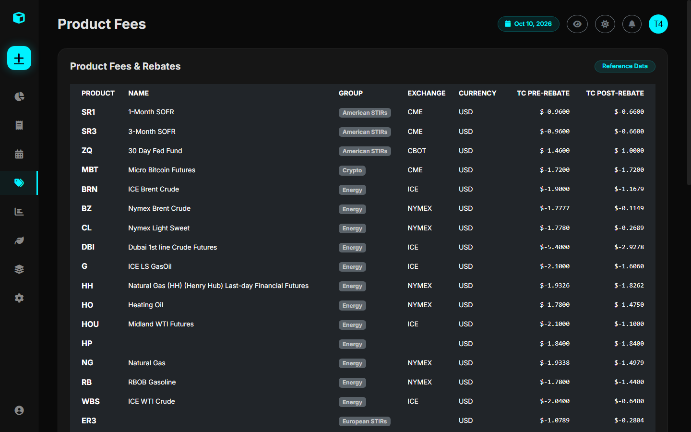
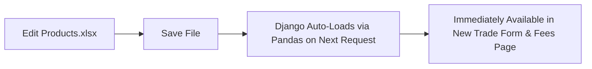

# How to Add More Products

All product reference definitions, tick sizes, point values, currencies, exchanges, and transaction fee schedules are maintained in the master reference file:

📁 **`Products.xlsx`** (located at the root of the project directory)

You can inspect the currently loaded products and their parameters inside the platform at `/products/fees/`:

---

## 1. Structure of `Products.xlsx`

The Excel sheet contains the following columns for each contract:

| Column Name | Data Type | Example Value | Description |
| :--- | :--- | :--- | :--- |
| `Product` | String (Unique) | `CL` | Ticker or symbol code used in the system. |
| `Name` | String | `Crude Oil (WTI)` | Full human-readable commodity name. |
| `ProductGroup` | String | `Energy` | Commodity sector grouping (Energy, Agriculture, Metals, etc.). |
| `Exchange` | String | `NYMEX` | Primary exchange (e.g., NYMEX, CBOT, CME, ICE, BMD). |
| `Currency` | String | `USD` | Denominated currency (`USD`, `MYR`, `EUR`, `GBP`). |
| `TickSize` | Float | `0.01` | Minimum allowable price fluctuation. |
| `TickValue` | Float | `10.0` | Monetary cash value of one minimum tick. |
| `PointValue` | Float | `1000.0` | Value of one full point move (e.g., $1.00 move in CL = $1,000). |
| `DisplayFactor`| Float | `1.0` | Visual display scaling factor (often 1.0 or 100 for cents). |
| `FXRate` | Float | `1.0` | Currency conversion multiplier to USD. |
| `TC_PreRebate` | Float | `2.50` | Full exchange + clearing fee per contract prior to broker rebate. |
| `TC_PostRebate`| Float | `1.20` | Net effective transaction fee per contract after member rebate. |

---

## 2. Step-by-Step: Adding a New Product

Suppose you want to add **E-mini S&P 500 Futures (`ES`)**:

### Step 1: Open `Products.xlsx`
Open `Products.xlsx` in Microsoft Excel, LibreOffice Calc, or any spreadsheet editor.

### Step 2: Add a New Row
Scroll to the bottom of the table and enter the contract specifications:

- **Product**: `ES`
- **Name**: `E-mini S&P 500`
- **ProductGroup**: `Equity Indices`
- **Exchange**: `CME`
- **Currency**: `USD`
- **TickSize**: `0.25` (Prices tick in increments of 0.25 points)
- **TickValue**: `12.50` ($12.50 per 0.25 tick)
- **PointValue**: `50.0` (1 index point = $50.00)
- **DisplayFactor**: `1.0`
- **FXRate**: `1.0`
- **TC_PreRebate**: `1.85`
- **TC_PostRebate**: `1.15`

### Step 3: Save the Excel File
Save and close `Products.xlsx`.

### Step 4: Verify in the Web Interface
1. Refresh your browser at `/products/fees/`.
2. Scroll to the **Equity Indices** section or search for `ES`.
3. Confirm that the new contract appears with its tick value ($12.50) and fee schedule ($1.15).

> **Pro Tip**: You do **not** need to restart the Django server or run migrations when editing `Products.xlsx`. The helper function `utils.get_products_data()` re-reads the Excel spreadsheet dynamically.
