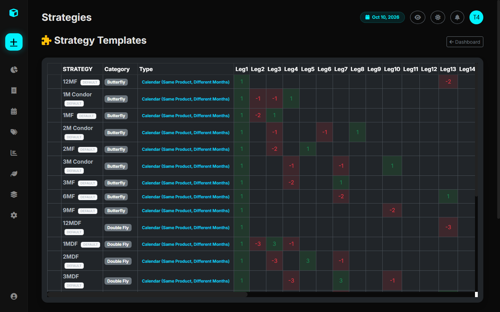

# How to Add Strategies & Pairs

The platform allows you to create reusable **Strategy Templates** and **Inter-Product Pairs** to streamline entry of complex multi-leg combinations.

Manage your templates and pairs on the **Strategies** page (`/strategies/`):



---

## 1. Understanding Strategy Templates (`StrategyTemplate`)

A Strategy Template stores the predefined **ratio configuration** of each leg relative to consecutive contract months.

### How Leg Ratios Map to Months:
- Ratio index `0`: Front Month ($M_1$)
- Ratio index `1`: Second Month ($M_2$)
- Ratio index `2`: Third Month ($M_3$)
- Ratio index `3`: Fourth Month ($M_4$)

### Common Examples:
- **1MS (1-Month Calendar Spread)**: `[1, -1]` (Buy Front Month, Sell Next Month)
- **2MS (2-Month Calendar Spread)**: `[1, 0, -1]` (Buy Front Month, Skip Month 2, Sell Month 3)
- **1MF (1-Month Fly)**: `[1, -2, 1]` (Buy 1x $M_1$, Sell 2x $M_2$, Buy 1x $M_3$)
- **Double Fly (DFly)**: `[1, -3, 3, -1]` (Buy 1x $M_1$, Sell 3x $M_2$, Buy 3x $M_3$, Sell 1x $M_4$)
- **G-Fly 2:1**: `[2, -3, 1]` (Custom ratio weighting)

---

## 2. Adding a Strategy Template via the UI

1. Navigate to `/strategies/`.
2. In the **"Add Strategy Template"** form:
   - **Name**: Give your strategy a short label (e.g., `3MS`, `Condor 1:1:1:1`).
   - **Category**: Select `Spread`, `Butterfly`, `DoubleFly`, or `Custom`.
   - **Strategy Type**: Select `Calendar` (Same Product, Different Months) or `InterProduct`.
   - **Leg Ratios**: Enter a valid JSON list of integers or floats.
     - Example for a 3-month spread: `[1, 0, 0, -1]`
     - Example for an unbalanced fly: `[1, -3, 2]`
3. Click **"Save Strategy Template"**.

The new template will immediately appear in the **Strategy Template** dropdown on the **New Trade** form (`/trades/new/`).

---

## 3. Adding Inter-Product Pairs (`InterProductPair`)

Inter-Product Pairs represent spreads traded between two different commodity underlyings (often across different exchanges).

### Common Commodity Pairs:
- **`CL-BZ`**: WTI Crude Oil vs. Brent Crude Oil
- **`HO-RB`**: Heating Oil vs. RBOB Gasoline (Crack spread component)
- **`ZW-ZC`**: Wheat vs. Corn (Feed grain spread)
- **`FCPO-BO`**: Palm Oil vs. Soybean Oil (Veg-oil spread)

### How to Add a Pair via the UI:
1. Navigate to `/strategies/`.
2. Locate the **"Inter-Product Pairs"** section on the right.
3. In the form:
   - **Pair Name**: e.g., `CL-BZ`
   - **Product 1 (Leg 1)**: `CL`
   - **Product 2 (Leg 2)**: `BZ`
4. Click **"Add Pair"**.

When entering a new trade, selecting `CL-BZ` will automatically generate both legs with their corresponding exchange parameters and tick conversions.

---

## 4. Seeding Templates via Python CLI

You can also programmatically seed default strategies using Django's management commands:

```bash
python manage.py seed_strategies
python manage.py seed_interproduct_pairs
```
