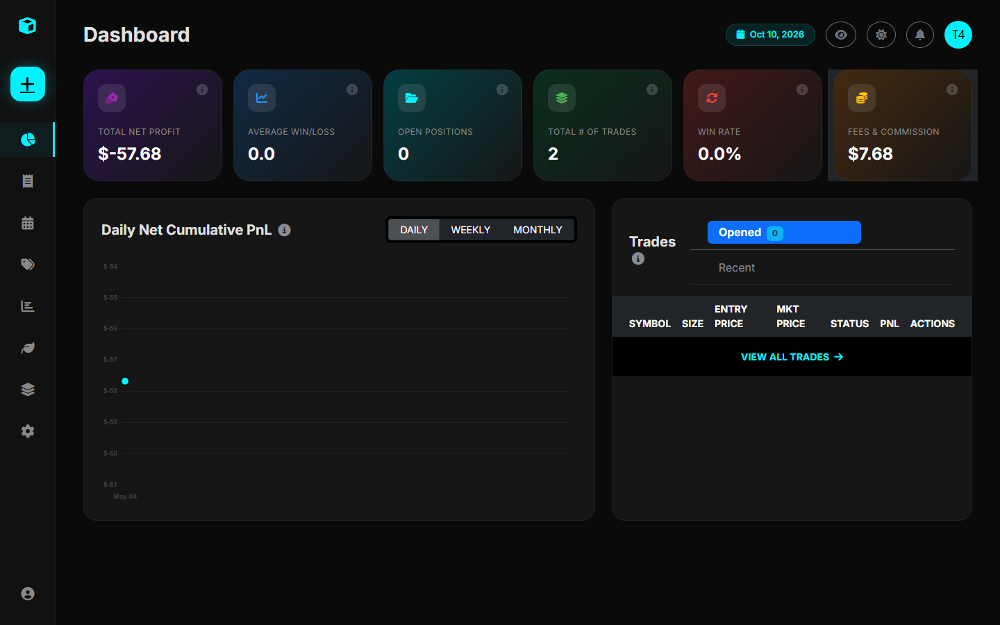
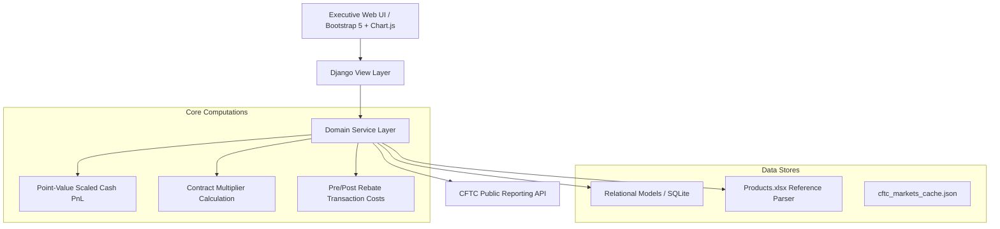

# Institutional Commodity & Derivatives Trade Journal

Welcome to the comprehensive technical documentation for the **Trade Journal** platform.

This platform is an institutional-grade trading journal, position risk tracker, and market intelligence suite engineered specifically for commodity and futures market practitioners, proprietary trading desks, and derivative quantitative analysts.

---

## Why Trade Journal?

Retail trading journals are almost universally designed for single-asset spot or stock trading. They assume simple "buy at X, sell at Y" models. In contrast, institutional commodity trading involves:

1. **Complex Multi-Leg Structures**: Calendar spreads (e.g., $CL$ June vs. July), butterflies ($1MF$), double-flies, and inter-product spreads (e.g., WTI Crude vs. Brent Crude).
2. **Contract Multipliers & Point Values**: Scaling price movements across disparate units (barrels, bushels, metric tonnes, index points) and multi-currency tick valuations.
3. **Exchange Fee Schedules & Rebates**: Accurate modeling of pre-rebate exchange fees versus net post-rebate execution fees.
4. **Supply & Demand Fundamentals**: Ingesting CFTC Commitments of Traders (COT) positioning data alongside physical agricultural fundamentals (such as Malaysian Palm Oil Board statistics).

---

## Core Capabilities at a Glance

| Module | Core Purpose | Key Features |
| :--- | :--- | :--- |
| **[Executive Dashboard](features/dashboard.md)** | Real-time performance & risk overview | Cumulative Net PnL curve, Win Rate, Win/Loss ratio, Privacy Mode toggle. |
| **[Multi-Leg Execution](features/trade-management.md)** | Strategy creation & execution | Outrights, Spreads, Butterflies, Double-Flies, Inter-Product Spreads. |
| **[Position Auditing](features/position-adjustments.md)** | Event-sourced lifecycle changes | Immutable log of `Open`, `Add`, `Reduce`, `Close` actions with volume weighting. |
| **[COT Positioning](features/cot-reports.md)** | CFTC positioning intelligence | Automated API sync for 1,300+ markets, Commercial vs. Speculator breakdowns. |
| **[Palm Oil Fundamentals](features/palm-oil.md)** | BMD FCPO physical market tracking | Forward curves, MPOB monthly S&D balance sheets, surveyor export monitors. |
| **[Planning & Calendar](features/calendar-planning.md)** | Seasonal & scheduled trade setup | Recurring setup calendar (Monthly, Yearly, Specific Months) with trade ideas. |
| **[Product Reference](guides/adding-products.md)** | Contract specs & fee management | Multi-exchange metadata, tick sizes, values, multipliers, and fee tables. |

---

## System Architecture

---

## Documentation Roadmap

- **[Getting Started](getting-started/overview.md)**: Architecture overview, local installation, and database migrations.
- **[Core Modules](features/dashboard.md)**: Deep dives into the dashboard, trade execution, and position audits.
- **[Step-by-Step Guides](guides/adding-products.md)**: Detailed instructions on expanding the product catalogue via `Products.xlsx` and adding new strategy templates.
- **[Technical Reference](reference/architecture.md)**: Relational schema, database models, and mathematical calculation formulas.
