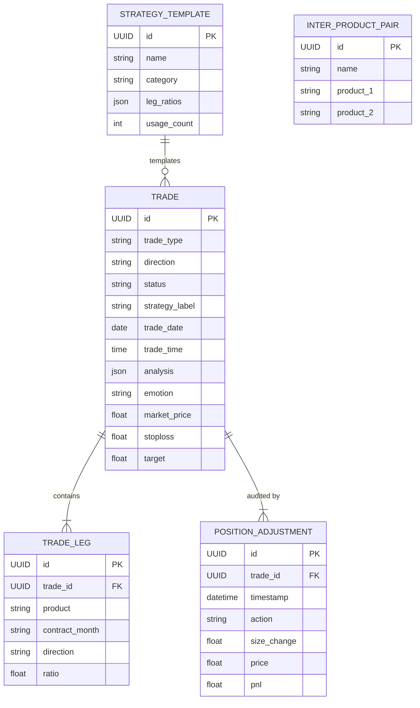

# Relational Models & Schemas

The Trade Journal data layer is modeled using Django's Object-Relational Mapping (ORM).

---

## 1. Entity-Relationship Overview

---

## 2. Model Definitions

### `Trade`
The root parent model representing a trade ticket. Holds directional stance (`Long`, `Short`), status (`Open`, `PartiallyReduced`, `Closed`), psychology metadata, and targets.

### `TradeLeg`
Represents an individual leg inside a multi-leg trade. Contains the product symbol, contract expiration month (e.g., `Jun 2026`), leg direction (`Buy` or `Sell`), and ratio multiplier.

### `PositionAdjustment`
The audit trail event record. Every mutation (`Open`, `Add`, `Reduce`, `Close`) creates a timestamped record storing `size_change`, `price`, and calculated `pnl`.

### `CotReport`
Local cache of US CFTC Commitments of Traders data. Indexed by `(report_date, market_code)` to prevent duplication.

### `PalmOilPriceAndOI`, `MPOBData`, `ExportSurveyorData`
Specialized physical commodity fundamental tables storing forward prices, open interest curves, MPOB balance sheets, and cargo surveyor export estimates.
